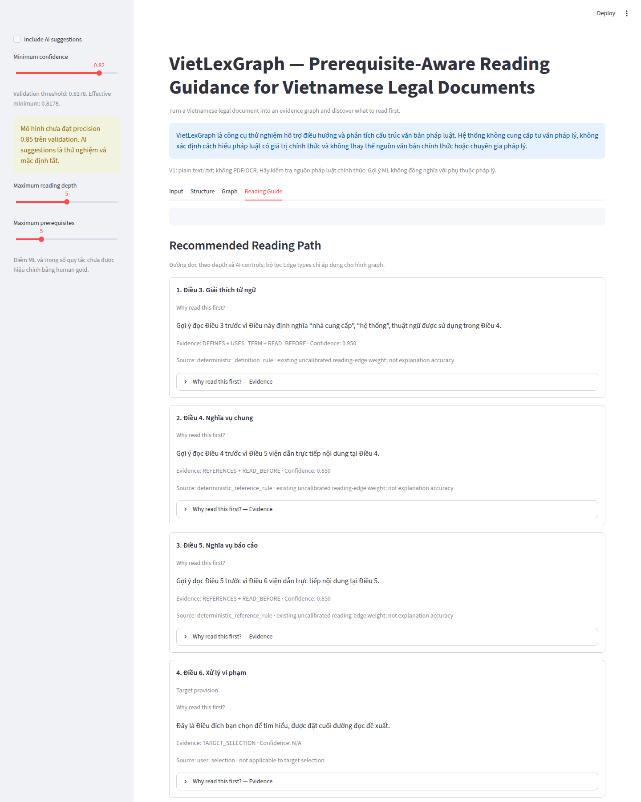
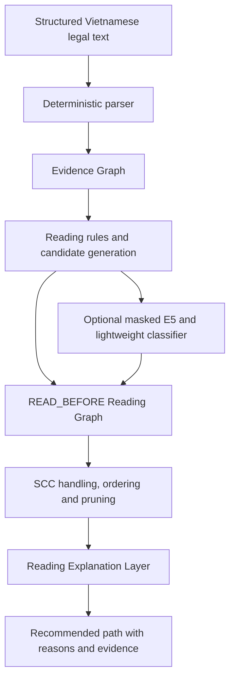

# VietLexGraph — Prerequisite-Aware Reading Guidance for Vietnamese Legal Documents

**Turn a Vietnamese legal document into an evidence graph and discover what to read first.**

Given a target article in one structured Vietnamese legal document, VietLexGraph recommends a compact sequence of provisions to read first, with evidence explaining each step.

**SOFTWARE READY / EXPLORATORY EVALUATION AVAILABLE**

This release is a research prototype evaluated on a limited corpus subset. The measured corpus contains **30 documents and 2,502 articles**. It is not a production legal service; independent human-only prerequisite assessment remains incomplete. ML suggestions are experimental and default off.



## Quick start

Python 3.12 is the tested environment. The deterministic demo needs no model download, private data or credentials.

```bash
git clone https://github.com/kytrungchauwork/VietLexGraph.git
cd VietLexGraph
python3 -m venv .venv
source .venv/bin/activate
pip install -r requirements-app.txt
streamlit run app.py
```

Click **Analyze Document**, open **Reading Guide**, and select the sample's Điều 6. Expected path: **Điều 3 → Điều 4 → Điều 5 → Điều 6**. The bundled document is synthetic. Paste structured text or upload a UTF-8 `.txt`; upload takes precedence when present.

Docker runs the same deterministic demo as a non-root user:

```bash
docker build -t vietlexgraph:1.0.0 .
docker run --rm -p 8501:8501 vietlexgraph:1.0.0
```

## Evidence and recommendations have different meanings

| Layer | Relations / output | Meaning |
|---|---|---|
| Evidence Graph | CONTAINS, REFERENCES, DEFINES, USES_TERM | Extracted structure and textual evidence |
| Reading Graph | READ_BEFORE | Derived reading recommendations with rule or ML provenance |
| Reading Path | Ordered article IDs, target last | Bounded reading sequence, with cycle and omission warnings |
| Explanation Layer | Reason, evidence, confidence | Why each selected provision may help with a later step |

A citation is evidence, not automatic prerequisite truth. Raw references point **citing → cited**. Reading edges point **candidate to read first → dependent target**. Rule weights and ML scores are uncalibrated; they are not probabilities of legal correctness.



The UI separates **Evidence Relations** and **Reading Guidance**. Inspect edge provenance, set depth and prerequisite budget, and optionally enable ML. Default depth and budget are both 5. Definition evidence has priority over references and ML when selecting a compact path; graph constraints govern ordering. Cycles are disclosed because not every edge can be satisfied by a linear order.

## Evidence-grounded explanations

VietLexGraph does not only provide a reading path. Each recommended step is accompanied by evidence explaining why that provision may help users understand the target provision.

The downstream rule-based explanation layer uses existing edges and metadata. It changes neither graph construction nor path membership/order. Explanation priority is **definition → explicit reference → procedure → structural context → ML prediction**. Role metadata alone creates no relationship.

For example: “Gợi ý đọc Điều 3 trước vì Điều này định nghĩa ‘phí’, thuật ngữ được sử dụng trong Điều 10.” Evidence retains the actual DEFINES and USES_TERM links through the term node. ML explanations explicitly say the article is *predicted* to help and include model origin. Confidence is copied from the supporting edge; target selection and unsupported cycle ordering display **N/A** rather than invented confidence.

## Optional model artifact

The inference-only model is distributed through [GitHub Release v1.0.0](https://github.com/kytrungchauwork/VietLexGraph/releases/tag/v1.0.0), not committed to Git. Although small, it is kept separate from source to make its version and integrity explicit.

```bash
pip install -r requirements.txt
python scripts/download_model.py
streamlit run app.py
```

The downloader verifies a pinned SHA-256 before installing `relation_model.pkl`, `scaler.pkl`, sanitized `metadata.json`, MIT LICENSE and a model README under ignored `models/`. It refuses to overwrite a different existing model; use `--destination` plus `VIETLEXGRAPH_MODEL_DIR` for another location. Enable AI suggestions in the sidebar after loading the model; they remain off by default.

- Version: **v1.0.0**; model name: **VietLexGraph relation model** (Logistic Regression).
- Asset: `vietlexgraph-model-v1.zip`, approximately 78 KiB; selected coefficients/scaler statistics only.
- SHA-256: `936f0f6b76a862b2f2e8937e62827e83d158062eecc2c359f6987443d999319b` (also in release `SHA256SUMS`).
- License: project-trained inference artifact **MIT**; upstream E5 weights retain their separate MIT notice and are downloaded on first ML use.
- No corpus text, user annotations, embeddings, TF-IDF vocabulary, dataset manifests or per-pair results are in the asset. Only load trusted pickle/joblib artifacts.

Evaluation scripts require separately prepared local data and training outputs. Without them, they explicitly print **NOT RUN** and exit cleanly; this is not a successful evaluation or an invented result.

## Exploratory results

The preliminary model uses explicit intra-document references as **weak supervision**, not verified prerequisite labels. Main inputs mask citation spans in both article body and title. The four pair baselines are TF-IDF cosine, E5 cosine, E5 + Logistic Regression, and E5 + structural features + MLP. Neither learned classifier met the validation precision target of 0.85; the selected LR remains experimental.

The **AI-assisted reviewed evaluation** contains 344 pairs: **54 positive / 290 negative**, across four documents and eight targets. Labels were generated by AI and reviewed by the project user. This does not establish independent human-only annotation or agreement between annotators. A document-disjoint split has 160 development pairs and 184 test pairs; neither overlaps weak training. The documents had previously been inspected, so the evaluation is exploratory.

Six reading systems were evaluated with unchanged settings. Selected test comparisons:

| System | Useful recommendations / all recommendations | Mean extra articles per target |
|---|---:|---:|
| HybridNoML | 2 / 5 | 0.75 |
| FullSystem, including ML | 4 / 20 | 4.00 |

ML recovered some additional labeled prerequisites but imposed substantially more reading. The existing ML-off default is retained. Test has only four targets, two without positive prerequisites; macro metrics are sensitive to these empty targets. One target has 25 labeled prerequisites but the path budget is 5. See [evaluation protocol and all results](docs/evaluation.md) for the six-system tables, metric conventions and limitations.

## Reproduce and test

Full training and developer dependencies are separate from the lightweight demo:

```bash
pip install -r requirements-dev.txt
python scripts/prepare_data.py --max-documents 30
python scripts/train.py
python scripts/evaluate.py
python scripts/ablate.py
python scripts/evaluate_paths.py
```

These commands download public upstream resources and generate **local ignored files**. The source repository does not include our corpus subset, checkpoints, annotations, split manifests or per-pair evaluation outputs. Private reviewed results therefore cannot be independently reproduced from this public repository alone. Code, synthetic tests and the deterministic demo can be reproduced without them. Dataset/model revisions and seed are pinned in `config.yaml`; see [data and model provenance](docs/DATA_SOURCES.md).

```bash
ruff check src scripts tests app.py
ruff format --check src scripts tests app.py
pytest
python scripts/check_public_release.py
```

[GitHub Actions](https://github.com/kytrungchauwork/VietLexGraph/actions) runs source-publication checks, lint, tests and coverage. A publication allowlist plus `.gitignore` excludes internal material. See [release checklist](docs/release.md).

## Related work and scope

Legal knowledge graphs, citation visualization and Vietnamese legal KGs predate this project. The proposed engineering contribution is document-local, target-specific prerequisite reading guidance with evidence and ordered path explanations; research novelty or superiority has not been established. See [Related Work](RELATED_WORK.md) for Graphie, the existing LexPath retrieval framework and Vietnamese legal KG research.

V1 supports structured plain text only. It has no LLM, chatbot, RAG, legal QA, PDF/OCR or cross-document retrieval. Main limitations are rule extraction errors, weak-label bias, a small corpus, uncalibrated scores, quadratic pair scoring, imperfect cycle ordering and greedy rather than globally optimal pruning. Read the [architecture and design rationale](docs/TECHNICAL_REPORT.md).

## License and disclaimer

Project code and original synthetic sample are released under the [MIT License](LICENSE). Downloaded datasets, model weights and dependencies retain their own licenses; see [third-party notices](THIRD_PARTY_NOTICES.md) and [security policy](SECURITY.md).

VietLexGraph is an experimental navigation tool. It does not provide legal advice or authoritative interpretation. Recommended reading paths are not legally required reading orders. Verify legal content against official sources and qualified professionals.
